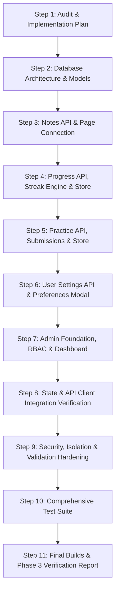

# AlgoFlow — Phase 3: Persistent Backend & Product APIs Implementation Plan

**Date**: October 14, 2026  
**Target**: Persistent Multi-User Backend & Product Data APIs  
**Status**: APPROVED FOR EXECUTION  

---

## 1. Codebase Audit: Current State vs. Target State

### 1.1 Existing Architecture Summary

| Component / Layer | Current Implementation Status | Data Source / Backing | Security & Reliability Assessment |
| :--- | :--- | :--- | :--- |
| **Express Server** | Hardened in Phase 2.1 (`helmet`, `cors`, `cookieParser`, `validateOrigin`, `apiRateLimiter`) | Node.js / Express 5 | Strong baseline. Fail-closed error handling and CSRF Origin validation active. |
| **MongoDB Connection** | `server/config/db.ts` connects via Mongoose; seeds demo users & 5 problems if empty | MongoDB (URI via `env.MONGODB_URI`) | Connects in dev/prod; skipped in test. Connection errors handled cleanly. |
| **Authentication System** | `/api/auth/register`, `/api/auth/login`, `/api/auth/logout`, `/api/auth/me` | Real MongoDB (`User` model) + HttpOnly JWT | Fully persistent, tested with 34 automated unit/integration tests. |
| **Notes Feature** | Frontend `NotesPage.tsx` uses isolated React `useState` with 3 hardcoded notes. `useNotesStore.ts` exists but is disconnected. Backend `/api/notes` has unpaginated, minimal CRUD without string limits or single-item fetch. | Frontend: Mock `useState` Backend: Basic unpaginated MongoDB routes | **Disconnected**: Frontend does not persist notes. Backend lacks pagination, query search, single note fetch, and robust Zod validation. |
| **Progress Feature** | Frontend `ProgressPage.tsx` and `Dashboard.tsx` render hardcoded static numbers (42 solved, 18 mastered, 14d streak, 68% progress). Backend `/api/progress` returns hardcoded 14 days and 42 solved. | Hardcoded static constants in UI & backend stub | **Fabricated**: No real progress tracking, no streak calculation from activity, no duplicate event prevention. |
| **Practice Feature** | Frontend `PracticePage.tsx` uses hardcoded `mockProblems` array (`p1`..`p6`). Submitting solutions sets fake static string. Backend `/api/problems` lists all problems with test cases exposed, and `/submit` fabricates random runtimes. | Hardcoded array in UI; minimal unpaginated backend | **Disconnected & Insecure**: Frontend doesn't call API; backend exposes test cases and fakes execution. |
| **Settings Feature** | Profile dropdown has a "Settings" button that only closes the dropdown (`setShowProfileModal(false)`). No settings route, component, or backend API exists. | Non-existent | **Missing**: User preferences (theme, preferred language, learning goals) cannot be viewed or updated. |
| **Admin System** | `GET /api/admin/metrics` exists for `ADMIN`/`SUPER_ADMIN`. No user management, no problem management, no audit logging, and no Admin UI view exists. | Minimal metric route only | **Incomplete**: Missing user administration, problem management, audit logging, and role hierarchy controls. |

---

## 2. Feature Source-of-Truth Audit Matrix

| Feature | Frontend State Source | API Client Method (`httpAdapter`) | Backend Route | Database Model | Persistent Across Sessions? |
| :--- | :--- | :--- | :--- | :--- | :---: |
| **User Authentication** | `useAuthStore` | `apiClient.auth.*` | `/api/auth/*` | `User` | **YES** (HttpOnly cookie) |
| **Notes** | Local `useState` in `NotesPage` (ignored `useNotesStore`) | `apiClient.notes.*` (basic) | `GET /api/notes` `POST /api/notes` `DELETE /api/notes/:id` | `Note` | **NO** (Resets on refresh) |
| **Progress & Analytics** | Static arrays in `ProgressPage` & `Dashboard` | `apiClient.progress.*` (basic) | `GET /api/progress` (hardcoded return) | `ProgressTrack` (stub) | **NO** (Static constants) |
| **Practice Problems** | Static `mockProblems` in `PracticePage` | `apiClient.practice.*` (stub) | `GET /api/problems` `POST /api/problems/:id/submit` | `Problem` `Submission` | **NO** (Static array) |
| **Practice Submissions** | Local `submitted` boolean in modal | None called | `POST /api/problems/:id/submit` (unwired) | `Submission` | **NO** (Resets on modal close) |
| **User Settings** | None | None | None | None | **NO** |
| **Admin Dashboard** | None (Header only checks `isAdmin` for badge) | None | `GET /api/admin/metrics` | None | **NO** |

---

## 3. Database Architecture Plan

### 3.1 Model Enhancements & Additions

1. **`User` Model (`server/models/User.ts`)**:
   - `name`: string, required, trimmed, max 60 chars.
   - `email`: string, required, unique, lowercase, trimmed, indexed.
   - `passwordHash`: string, select: false, never exposed in JSON or API responses.
   - `role`: enum `['USER', 'ADMIN', 'SUPER_ADMIN']`, default `'USER'`.
   - `accountStatus`: enum `['active', 'suspended']`, default `'active'`, indexed.
   - `preferences`:
     - `theme`: enum `['dark', 'system']`, default `'dark'`.
     - `preferredLanguage`: enum `['cpp', 'c', 'java', 'python']`, default `'cpp'`.
     - `dailyGoalMinutes`: number, min 5, max 300, default 30.
   - `streakDays`: number, default 0 (computed from activity logs).
   - `solvedCount`: number, default 0 (computed from accepted submissions).
   - `algorithmsLearned`: number, default 0 (computed from completed tracks).
   - Timestamps: `createdAt`, `updatedAt`.

2. **`Note` Model (`server/models/Note.ts`)**:
   - `userId`: `Schema.Types.ObjectId`, ref `'User'`, required, indexed.
   - `title`: string, required, max 120 chars, trimmed.
   - `content`: string, required, max 10,000 chars.
   - `tags`: array of trimmed strings, max 10 tags, max 30 chars each.
   - `algorithmId`: optional string, indexed.
   - Compound index: `{ userId: 1, updatedAt: -1 }`.
   - Text index on `{ title: 'text', content: 'text', tags: 'text' }` for efficient keyword search.

3. **`ProgressTrack` Model (`server/models/ProgressTrack.ts`)**:
   - `userId`: `Schema.Types.ObjectId`, ref `'User'`, required, indexed.
   - `algorithmId`: string, required.
   - `status`: enum `['not_started', 'in_progress', 'completed']`, default `'not_started'`.
   - `stepsCompleted`: number, default 0.
   - `totalSteps`: number, default 0.
   - `lastStepIndex`: number, default 0.
   - `completedAt`: optional Date.
   - `lastActivityAt`: Date, default `Date.now`.
   - Unique compound index: `{ userId: 1, algorithmId: 1 }`.

4. **`ActivityLog` Model (`server/models/ActivityLog.ts`)**:
   - `userId`: `Schema.Types.ObjectId`, ref `'User'`, required, indexed.
   - `date`: string (ISO YYYY-MM-DD), indexed.
   - `activityType`: enum `['algorithm_step', 'algorithm_completion', 'practice_attempt', 'practice_solve']`.
   - `targetId`: string (algorithm ID or problem ID).
   - `minutes`: number, default 0.
   - `steps`: number, default 0.
   - Compound index: `{ userId: 1, date: 1 }`.
   - Unique compound index for deduplication: `{ userId: 1, date: 1, activityType: 1, targetId: 1 }` to prevent repeated events from inflating streaks or stats.

5. **`Problem` Model (`server/models/Problem.ts`)**:
   - `problemId`: string (slug), unique, indexed.
   - `title`: string, required, max 150 chars.
   - `difficulty`: enum `['Easy', 'Medium', 'Hard']`, indexed.
   - `category`: string, required, indexed.
   - `tags`: array of strings, indexed.
   - `description`: string, required.
   - `constraints`: array of strings.
   - `starterCode`: `{ cpp: string, c: string, java: string, python: string }`.
   - `testCases`: array of `{ input: string, expected: string, isHidden?: boolean }`. Hidden test cases filtered out from standard problem listing and detail endpoints.
   - `publicationStatus`: enum `['draft', 'published', 'archived']`, default `'published'`, indexed.
   - Timestamps: `createdAt`, `updatedAt`.

6. **`Submission` Model (`server/models/Submission.ts`)**:
   - `userId`: `Schema.Types.ObjectId`, ref `'User'`, required, indexed.
   - `problemId`: string, required, indexed.
   - `language`: enum `['cpp', 'c', 'java', 'python']`, required.
   - `code`: string, required, max 50,000 chars.
   - `status`: enum `['SUBMITTED', 'PENDING', 'ACCEPTED', 'WRONG_ANSWER']`, default `'SUBMITTED'`.
   - `runtimeMs`: number, default 0.
   - `memoryMb`: number, default 0.
   - `passed`: boolean, default false.
   - `message`: string.
   - Compound index: `{ userId: 1, problemId: 1, createdAt: -1 }`.

7. **`AdminAuditLog` Model (`server/models/AdminAuditLog.ts`)**:
   - `adminId`: `Schema.Types.ObjectId`, ref `'User'`, required, indexed.
   - `action`: string, required (e.g. `'USER_STATUS_UPDATE'`, `'PROBLEM_CREATE'`, `'PROBLEM_UPDATE'`, `'ROLE_CHANGE'`).
   - `targetType`: string, required (`'USER'`, `'PROBLEM'`, `'SYSTEM'`).
   - `targetId`: string, required.
   - `details`: object with relevant diff or parameters.
   - `ipAddress`: string.
   - `createdAt`: Date, default `Date.now`.
   - Index: `{ createdAt: -1 }`.

---

## 4. API Endpoints Specification

### 4.1 Notes API (`/api/notes`)
- `GET /api/notes`: Scoped to `req.user.userId`. Query parameters: `page` (default 1), `limit` (default 20, max 50), `tag` (filter), `search` (keyword search on title and content). Returns `{ notes: Note[], total: number, page: number, totalPages: number }`.
- `GET /api/notes/:id`: Fetch specific note. Scoped strictly to owner (`userId: req.user.userId`). Returns 404 if not found or unowned.
- `POST /api/notes`: Create note with Zod validation (`title` max 120, `content` max 10000, `tags` array). Scoped to `req.user.userId`.
- `PUT /api/notes/:id`: Update note with ownership validation. Scoped to `userId: req.user.userId`.
- `DELETE /api/notes/:id`: Delete note with ownership validation. Scoped to `userId: req.user.userId`.

### 4.2 Progress & Activity API (`/api/progress`)
- `GET /api/progress/summary`: Current user summary including:
  - `streakDays`: Calculated from consecutive distinct active days in `ActivityLog`.
  - `solvedCount`: Count of unique problems with `status: 'ACCEPTED'` in `Submission` or tracked solves.
  - `algorithmsLearned`: Count of `ProgressTrack` records with `status: 'completed'`.
  - `weeklyActivity`: Aggregation of last 7 calendar days from `ActivityLog` (`{ day, minutes, steps }`).
  - `difficultyDistribution`: Solved problem counts broken down by Easy, Medium, Hard.
  - `overallProgressPercent`: Percentage across platform algorithms.
- `GET /api/progress/algorithms`: Returns all algorithm tracks for current user.
- `POST /api/progress/activity`: Record legitimate learning activity. Validated with Zod (`minutes` max 180, `steps` max 1000, `algorithmId`, `activityType`). Deduplicated per user/date/activityType/targetId to prevent inflation.
- `PUT /api/progress/algorithms/:algorithmId`: Update algorithm progress or mark as completed (`status`, `stepsCompleted`, `totalSteps`, `lastStepIndex`). Triggers recalculation of `algorithmsLearned`.

### 4.3 Practice API (`/api/problems` & `/api/submissions`)
- `GET /api/problems`: List published problems. Filterable by `difficulty`, `category`, and `search`. Paginated (`page`, `limit`). If authenticated, attaches user's `solved: boolean` status by cross-referencing user submissions. Strips hidden test cases.
- `GET /api/problems/:id`: Fetch single problem by `problemId`. Strips hidden test cases. Includes user's previous best submission if authenticated.
- `POST /api/problems/:id/submit`: Record practice attempt. Scoped to authenticated user. Validates language and code length. Records `Submission`. Note: Phase 3 clearly acknowledges code runner sandbox is scheduled for Phase 4; records submission attempt honestly.
- `GET /api/problems/:id/submissions`: Returns current user's submission history for the problem (paginated, latest first).

### 4.4 User Settings API (`/api/users`)
- `GET /api/users/profile`: Returns current user profile and settings (`name`, `email`, `role`, `avatarUrl`, `preferences`, `streakDays`, `solvedCount`, `algorithmsLearned`).
- `PATCH /api/users/profile`: Update display name and preferences (`theme`, `preferredLanguage`, `dailyGoalMinutes`).
  - **Strict Security Guard**: Zod schema explicitly forbids updates to `role`, `accountStatus`, `email`, `streakDays`, `solvedCount`, or `passwordHash`.

### 4.5 Admin API (`/api/admin`)
- `GET /api/admin/metrics`: Platform metrics (`totalUsers`, `totalProblems`, `totalSubmissions`, `activeUsersPastWeek`, server uptime). Requires `ADMIN` or `SUPER_ADMIN`.
- `GET /api/admin/users`: Paginated user list with search (`q`), role filter, status filter. Requires `ADMIN` or `SUPER_ADMIN`. Never exposes password hashes.
- `PATCH /api/admin/users/:id/status`: Update account status (`'active'` | `'suspended'`). Requires `ADMIN` or `SUPER_ADMIN`. Cannot suspend own account.
- `PATCH /api/admin/users/:id/role`: Update user role (`'USER'` | `'ADMIN'`). Restricted strictly to `SUPER_ADMIN`.
- `POST /api/admin/problems`: Create new problem (requires `ADMIN` or `SUPER_ADMIN`).
- `PUT /api/admin/problems/:id`: Update existing problem (requires `ADMIN` or `SUPER_ADMIN`).
- `DELETE /api/admin/problems/:id`: Archive problem (soft delete or status `'archived'`).
- `GET /api/admin/audit-logs`: Paginated audit log of admin operations.

---

## 5. Frontend & State Integration Plan

1. **`src/api/client.ts` & `httpAdapter.ts`**:
   - Update interfaces: `NoteRecord`, `PracticeProblem`, `UserProfile`, `UserProgressData`, `SubmissionRecord`, `UserSettings`.
   - Add practice endpoints: `getProblems(params)`, `getProblemById(id)`, `submitSolution(id, lang, code)`, `getSubmissions(id)`.
   - Add notes endpoints: `getNotes(params)`, `getNoteById(id)`, `createNote(data)`, `updateNote(id, data)`, `deleteNote(id)`.
   - Add progress endpoints: `getProgressSummary()`, `getAlgorithmTracks()`, `recordActivity(data)`, `updateAlgorithmProgress(id, data)`.
   - Add settings endpoints: `getUserSettings()`, `updateUserSettings(data)`.
   - Add admin endpoints: `getAdminMetrics()`, `getAdminUsers(params)`, `updateUserStatus(id, status)`, `updateUserRole(id, role)`, `adminSaveProblem(data)`, `getAuditLogs(params)`.

2. **Zustand Store Updates**:
   - `useNotesStore.ts`: Wire directly to `apiClient.notes`. Handle loading, error, empty, search filter, active note selection, and persistent CRUD.
   - `usePracticeStore.ts`: Wire to `apiClient.practice`. Manage problem listing, active problem, submissions history, and submit actions.
   - `useProgressStore.ts`: New store or extend progress state for live summary data, algorithm tracks, and activity recording.
   - `useAuthStore.ts`: Extend to handle user settings updates.

3. **UI Page Connections (Preserving Aesthetics & Layout)**:
   - `NotesPage.tsx`: Replace local static `useState` with `useNotesStore`. Connect search, tag filtering, creation modal, edit modal, and deletion confirmation to real APIs.
   - `PracticePage.tsx`: Connect to `usePracticeStore`. Replace hardcoded array with fetched problems. Allow filtering by difficulty and topic. Record real submissions and display honest submission status.
   - `ProgressPage.tsx`: Connect to `useProgressStore`. Display real calculated metrics: active streak, algorithms mastered, problems solved, weekly activity chart, and topic proficiency radar.
   - `Dashboard.tsx`: Connect stats cards and activity charts to `useProgressStore` or `useAuthStore` so real user progress is reflected.
   - `SettingsModal.tsx` or `SettingsDrawer.tsx`: Add clean settings dialog accessible from Header "Settings" menu item.
   - `AdminPage.tsx`: Implement dedicated Admin Dashboard view at `/admin` (wrapped in `ProtectedRoute` requiring `ADMIN` or `SUPER_ADMIN`), with tabs for Platform Metrics, User Management, Problem Management, and Audit Logs. Add Admin navigation link in Header when user has admin role.

---

## 6. Implementation Sequence

1. **Step 2**: Implement/update Mongoose models (`User`, `Note`, `ProgressTrack`, `ActivityLog`, `Problem`, `Submission`, `AdminAuditLog`). Update `seedDevData.ts`.
2. **Step 3**: Implement enhanced `noteRoutes.ts` with pagination, search, single-item fetch, and Zod validation. Wire `useNotesStore.ts` and `NotesPage.tsx`.
3. **Step 4**: Implement `progressRoutes.ts` with real streak calculation, weekly activity aggregation, algorithm tracks, and duplicate activity prevention. Wire `ProgressPage.tsx` and `Dashboard.tsx`.
4. **Step 5**: Implement `problemRoutes.ts` and `submissionRoutes.ts` with pagination, difficulty/topic filtering, test-case masking, and attempt recording. Wire `usePracticeStore.ts` and `PracticePage.tsx`.
5. **Step 6**: Implement user settings route (`userRoutes.ts`), DTO sanitization, and preferences modal in Header.
6. **Step 7**: Implement admin routes (`adminRoutes.ts`), role hierarchy (`ADMIN` vs `SUPER_ADMIN`), audit logging, and `AdminPage.tsx` at `/admin`.
7. **Step 8**: Update `client.ts` and `httpAdapter.ts` with complete type definitions and HTTP endpoints.
8. **Step 9**: Audit security: ownership validation, Zod validation, error masking, Mongo query sanitization.
9. **Step 10**: Write comprehensive automated unit and integration tests for Notes, Progress, Practice, Settings, and Admin.
10. **Step 11**: Run full verification suite (`tsc -b`, `npm test`, `npm run build`) and produce `docs/phase-3-implementation-report.md`.
